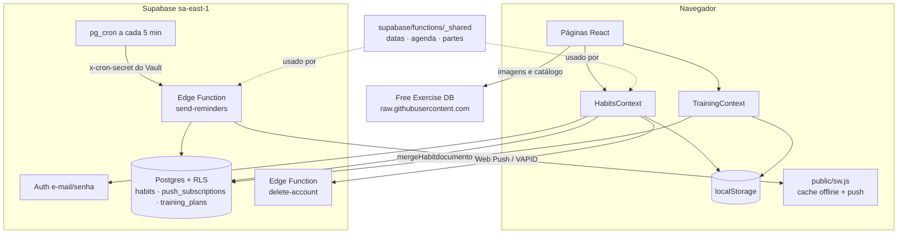
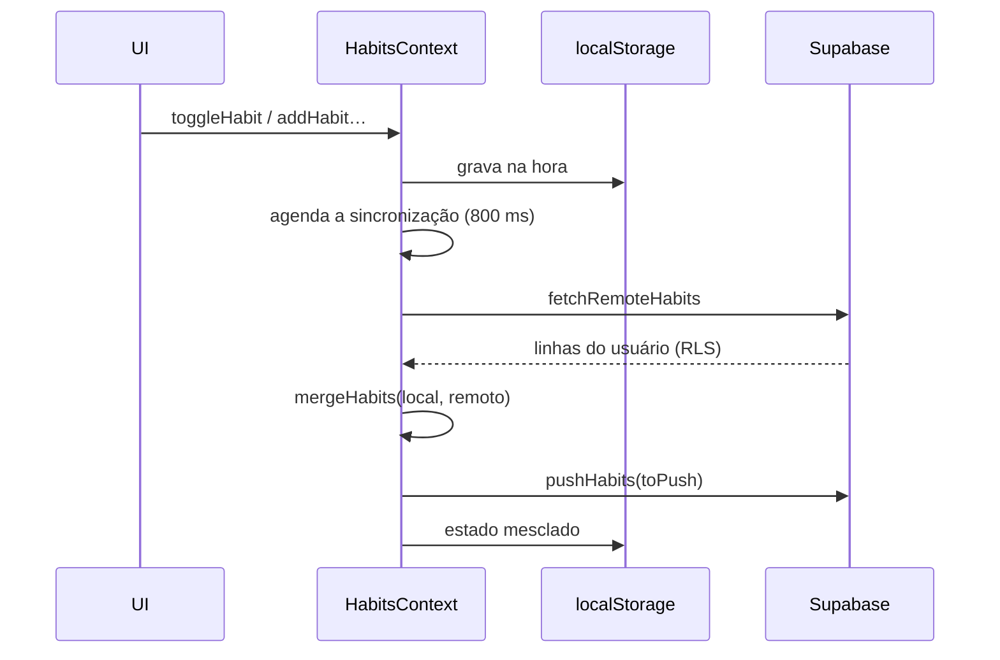

# Mapa do código

> Gerado com a skill Cartographer em 2026-10-22T17:12:01Z, na branch `redesign` (commit `5d8c398`).

**My Daily Habits** é um PWA em React para acompanhar hábitos e montar treinos. Os dados ficam no `localStorage` e, com login, sincronizam pelo Supabase entre aparelhos. Os lembretes chegam por Web Push. O site está em https://my-daily-habits.vercel.app.

**Stack:** React 19, React Router 7 (modo declarativo), Vite 8, oxlint, `@supabase/supabase-js`. Não há framework de testes: os unitários usam `node:assert`, e o e2e conversa com o Chrome direto pelo DevTools Protocol.

## Visão geral



## Estrutura de pastas

```
my-daily-habits/
├── src/
│   ├── main.jsx              # BrowserRouter > HabitsProvider > TrainingProvider > App; registra o SW em produção
│   ├── App.jsx               # todas as rotas
│   ├── App.css · index.css   # estilos (tokens de tema em index.css, componentes em App.css)
│   ├── layouts/              # AppLayout (topo, navegação, tema) e HabitsLayout
│   ├── pages/                # uma página por rota; pages/training/ é a aba de treino
│   ├── components/           # peças reutilizáveis (HabitForm, HabitCard, ExerciseDemo, ExercisePicker…)
│   ├── context/              # estado global: HabitsContext + TrainingContext, com hooks useHabits/useTraining
│   ├── services/             # rede: Supabase (cloud), lembretes, catálogo externo, sugestões
│   ├── utils/                # regras puras + testes unitários
│   └── data/                 # dados estáticos: 79 exercícios, hábitos iniciais
├── public/
│   ├── sw.js                 # service worker: cache offline e exibição das notificações
│   ├── manifest.webmanifest  # PWA
│   └── api/sugestoes.json    # "API" estática da página Sugestões
├── supabase/
│   ├── functions/_shared/    # regras de datas, agenda e partes do dia (Deno e navegador)
│   ├── functions/send-reminders/  # envia os lembretes (chamada pelo pg_cron)
│   ├── functions/delete-account/  # apaga a conta do usuário logado
│   ├── migrations/           # tabelas, RLS e o agendamento do cron
│   └── config.toml           # alinhado ao servidor (MFA, pool, storage)
├── tests/e2e.mjs             # 47 testes de navegador, sem dependências
├── .github/workflows/ci.yml  # lint → unitários → e2e
├── vercel.json               # rewrite de tudo para /index.html (SPA)
└── docs/ · ATIVIDADE.md · DIARIO.md · RESPOSTAS.md · AI_TUTOR.md · LEIA-ME.md   # material do curso (ver Cuidados)
```

`supabase/.temp/`, `dist/`, `.env` e `.vercel/` são locais e ficam fora do git.

## Módulos

### Rotas e layout

**Arquivos:** `src/App.jsx`, `src/layouts/AppLayout.jsx`, `src/layouts/HabitsLayout.jsx`

| Rota | Página |
|------|--------|
| `/` | `HomePage`: hábitos de hoje |
| `/habitos`, `/habitos/:habitId` | `HabitsPage` (dentro de `HabitsLayout`), `HabitDetailsPage` |
| `/novo` | `NewHabitPage` |
| `/progresso` | `ProgressPage`, protegida por `ProtectedProgressRoute` |
| `/treino` | `TrainingPage`: perfil, lista de treinos, exportação |
| `/treino/avaliacao` | `AssessmentPage`: medidas, objetivo, PAR-Q |
| `/treino/exercicios`, `/treino/exercicios/novo`, `/treino/exercicios/:exerciseId` | `LibraryPage`, `CustomExercisePage`, `ExercisePage` |
| `/treino/:workoutId` | `WorkoutPage`: editar um treino |
| `/sugestoes`, `/sobre`, `/conta`, `*` | `SuggestionsPage`, `AboutPage`, `AccountPage`, `NotFoundPage` |

O `AppLayout` guarda o tema em `my-daily-habits:theme` e só mostra o botão de conta quando o Supabase está configurado (`cloud.enabled`).

### Hábitos

**Estado:** `src/context/HabitsContext.jsx`. Expõe `habits`, `completedCount`, `dueCount`, `today`, `toggleHabit`, `togglePart`, `addHabit`, `updateHabit`, `removeHabit`, `replaceHabits` e `cloud` (com `enabled`, `user`, `sync`, `syncNow`, `signOut`, `deleteAccount`, `recovering`, `finishRecovery`).

**Formato de um hábito:** `{ id, title, goal, emoji, schedule, parts?, partsDone, completedDates, updatedAt, deleted? }`.

| Arquivo | Papel |
|---------|-------|
| `utils/habits.js` | `sanitizeHabits`: valida tudo o que vem do `localStorage`, do backup ou da nuvem |
| `utils/sync.js` | `mergeHabits` (vence o `updatedAt` mais recente, hábito por hábito), `toRow`, `fromRow` |
| `utils/dates.js`, `schedule.js`, `parts.js` | só reexportam `supabase/functions/_shared/*` |
| `_shared/schedule.js` | agenda diária, semanal (N vezes) ou em dias fixos; sequências (`getStreak`, `getBestStreak`) |
| `_shared/parts.js` | partes do dia (até `MAX_PARTS`), progresso e horário de lembrete de cada parte |
| `components/HabitForm.jsx` | formulário de criar e editar, com agenda, partes e lembrete |
| `components/BackupPanel.jsx` | exporta e importa o JSON de backup |

### Nuvem e conta

| Arquivo | Papel |
|---------|-------|
| `services/cloud.js` | cliente `supabase` (fica `null` sem as variáveis `VITE_SUPABASE_*`), `fetchRemoteHabits`, `pushHabits`, `friendlyError` |
| `services/reminders.js` | assinatura de push no navegador (`enableReminder`, `updateReminder`, `disableReminder`, `sendTestReminder`) |
| `pages/AccountPage.jsx` | login e cadastro, recuperação de senha, lembretes, exclusão da conta |
| `supabase/functions/send-reminders/index.ts` | calcula a hora local de cada assinatura, conta os hábitos pendentes e as partes que vencem agora, e envia com `web-push` |
| `supabase/functions/delete-account/index.ts` | apaga o usuário autenticado pelo JWT dele |

### Treino

**Estado:** `src/context/TrainingContext.jsx`. Guarda `{ profile, workouts, customExercises, updatedAt }` em `my-daily-habits:training` e expõe `findExercise`, `saveProfile(profile, { regenerate })`, ações de treino (`addWorkout`, `updateWorkout`, `removeWorkout`), de item (`addItem`, `updateItem`, `removeItem`, `moveItem`) e de exercício próprio (`addCustomExercise`, `removeCustomExercise`).

| Arquivo | Papel |
|---------|-------|
| `utils/training.js` | o "cérebro" do treino: `GOAL_RULES` (15 objetivos), `prescription`, `exercisesFor`, `buildPlan`, IMC, PAR-Q, `planToCsv`, `filterExercises`, `videoUrlFor`, `describeGoal` |
| `data/exercises.js` | 79 exercícios montados pelos ajudantes `strength(...)`, `cardio(...)` e `stretch(...)`, mais `GROUPS`, `EQUIPMENT`, `TYPES` e `IMAGE_BASE` |
| `services/catalog.js` | baixa o catálogo completo do Free Exercise DB (`dist/exercises.json`) sob demanda e traduz músculos e equipamentos |
| `components/ExerciseDemo.jsx` | alterna as imagens `0.jpg` e `1.jpg` como animação |
| `components/ExercisePicker.jsx` | busca e adiciona exercícios a um treino |
| `utils/download.js` | `downloadFile` para o CSV |

**Como `buildPlan` monta o plano:**
1. Filtra os exercícios pelo equipamento do local, pelo nível (limitado pelo `maxLevel` do objetivo), pelos exercícios que o objetivo evita (`avoid`) e pelas restrições.
2. Divide os dias: híbrido (corpo inteiro) ou focado (`FOCUSED_SPLITS` de 2 a 5 dias). O estilo alongamento usa `STRETCH_ROUTINES`.
3. Preenche cada treino em rodízio pelos grupos. Os grupos de `emphasis` vêm primeiro e ganham uma vaga extra. Na academia, peso corporal fica por último.
4. Ordena por grupo muscular, acrescenta cardio se o objetivo pedir e termina com os alongamentos (`stretches` e `stretchGroups`).
5. Junta o aquecimento e a `note` do objetivo nas observações.

## Fluxos de dados

### Sincronização dos hábitos



Login, volta da aba e um timer também disparam a sincronização. Uma exclusão vira lápide (`deleted: true`) para chegar aos outros aparelhos. O treino sincroniza como **documento único** em `training_plans`: vence o `updatedAt` mais recente, sem mesclar.

### Lembretes

```mermaid
sequenceDiagram
    participant Cron as pg_cron (5 min)
    participant SR as send-reminders
    participant DB as Postgres
    participant SW as sw.js no aparelho
    Cron->>SR: POST com x-cron-secret
    SR->>DB: assinaturas + hábitos de cada usuário
    SR->>SR: hora local · pendentes · partes que vencem
    SR->>SW: web-push { title, body, url, tag }
    SW->>SW: showNotification; ao clicar, abre a url
```

## Convenções

- Interface, comentários, nomes de rota e mensagens de commit em português.
- Regras de negócio ficam em funções puras em `utils/` ou `_shared/`, com teste. Componentes só exibem e chamam ações do contexto.
- Todo dado externo (armazenamento, backup, nuvem) passa por `sanitize*` antes de entrar no estado.
- Componentes só exportam componentes (regra `only-export-components`). Ajudantes ficam em outros arquivos.
- Nada impuro no render: `new Date()` vai em `useState(() => …)`. Nada de `setState` direto em efeito; use callbacks ou `useEffectEvent`.
- Os testes e2e esperam o estado da tela com `expectJs`, em vez de usar pausas fixas.

## Cuidados

- **As regras de datas, agenda e partes ficam em `supabase/functions/_shared/`.** Os arquivos `src/utils/dates.js`, `schedule.js` e `parts.js` só reexportam. Edite os de `_shared` em JS puro, sem imports de npm, porque o Deno também os usa. Depois, publique o `send-reminders` de novo.
- **Push na `redesign` publica em produção.** O `main` é a entrega do curso: a Vercel ignora builds dele, e a `redesign` não deve ser mesclada no `main`.
- **O deploy automático pode atrasar:** em 2026-10-22 o aviso do GitHub chegou à Vercel de 10 a 30 minutos depois do push. Espere antes de publicar pelo CLI (`npx vercel deploy --prod`), senão o mesmo commit é publicado duas vezes.
- **O `send-reminders` é publicado com `--no-verify-jwt`.** Quem autentica é o cabeçalho `x-cron-secret`, comparado ao segredo `reminders_cron_secret` do Vault.
- **A exclusão de conta é uma Edge Function de propósito.** A versão em SQL `security definer` gerava aviso no `db advisors`.
- **O plano gratuito do Supabase não permite editar os e-mails.** Por isso o login é por e-mail e senha, sem confirmação.
- **A chave `service_role`/secret nunca vai para o front, os logs ou a conversa.** Só a publishable é pública.
- **O CSV começa com BOM** para o Excel abrir os acentos. O teste lê os bytes crus, porque `blob.text()` remove o BOM.
- **O service worker tem dois caches:** `my-daily-habits-v4` para o app e `my-daily-habits-exercicios-v1` para as imagens. Mude o nome quando a estratégia de cache mudar.
- **Seletores nos testes:** `.icon-button` também acerta o link de conta, então os testes usam `button.icon-button`.
- **Material do curso:** `ATIVIDADE.md`, `DIARIO.md`, `RESPOSTAS.md`, `AI_TUTOR.md`, `LEIA-ME.md` e `docs/0*-*.md` pertencem ao curso. O conteúdo de autoria é escrito pelo aluno.

## Onde mexer

| Para… | Arquivos |
|-------|----------|
| Criar um objetivo de treino | uma entrada em `GOAL_RULES` (`src/utils/training.js`) + teste em `training.test.js` |
| Criar um exercício | `src/data/exercises.js` (`strength`, `cardio` ou `stretch`; a pasta da imagem vem do Free Exercise DB) |
| Mudar como o plano é montado | `buildPlan` e `exercisesFor` em `src/utils/training.js` |
| Criar uma página | `src/pages/` + rota em `src/App.jsx` + link em `AppLayout.jsx` (se for para o menu) |
| Mudar agenda, sequência ou partes | `supabase/functions/_shared/*.js` + `utils.test.js` + publicar `send-reminders` |
| Mudar o banco | nova migração em `supabase/migrations/` → `npx --yes supabase@2.121.0 db push --linked` → `db advisors` |
| Mudar os lembretes | cliente em `services/reminders.js`, exibição em `public/sw.js`, envio em `functions/send-reminders` |
| Mudar a sincronização | `utils/sync.js` (hábitos) ou `TrainingContext.jsx` (treino) |

## Comandos

```bash
npm run dev          # Vite em desenvolvimento (sem service worker)
npm run lint         # oxlint
npm test             # unitários: utils.test.js + training.test.js
npm run test:e2e     # build + 47 testes no Chrome (E2E_URL=https://… testa outro endereço)
```

A sincronização real entre dois aparelhos é testada por um script fora do repositório, com contas `e2e-*@mydailyhabits.dev`. Apague essas contas depois de rodar.
